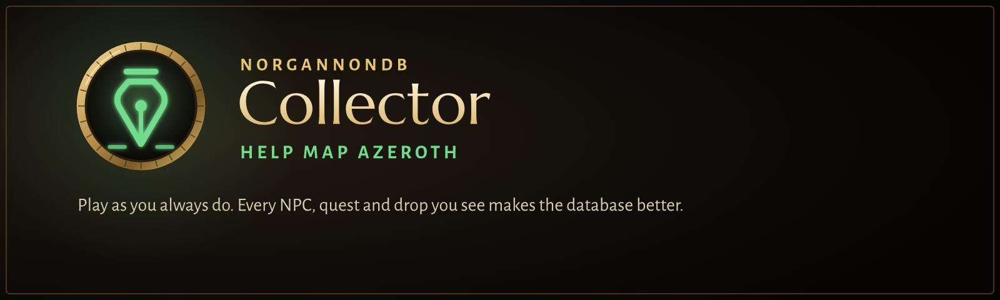

# NorgannonDB Collector

> [!WARNING]
> **Very much a work in progress.** This is an early build for WoW Forever (client 1.60.1), in
> active development and testing. Expect missing features, rough edges, bugs, and changes that
> break things between versions. Bug reports and feedback are welcome in
> [Issues](../../issues).

**Play as you always do. Every NPC, quest and drop you see makes the database better.**

NorgannonDB is the open game database behind Clairvoyance, Oracle, Foresight and Archivum. It
started from Questie and pfQuest, but WoW Forever changed spawns, quests and drops, and some things
(like boss drop chances) were never known at all. The Collector fills those gaps from real play.

* **Nothing to do.** It runs quietly in the background, with no windows or prompts while you play.
  It saves its work for after combat, so it never gets in your way during a fight.
* **Private.** No character names and no other players are ever recorded or exported.
* **Rewarding.** At each login it shows what your last session found, including mismatches
  NorgannonDB didn't know about.

## Sharing your data

1. Type **`/ndbc export`**. A window opens with your data on one line, already selected.
2. Press **Ctrl+C**.
3. Paste it into a message or a text file for the NorgannonDB maintainer.

Exports include everything you've recorded so far, so send a fresh one every now and then.

By sending your data you let it be included in NorgannonDB, which is published under GPL-3.0.
Exports contain no character names.

## Commands

| Command | What it does |
|---|---|
| `/ndbc export` | open the export window |
| `/ndbc stats` | what you've recorded so far |
| `/ndbc report [type] [n]` | what you found that NorgannonDB has wrong or missing |
| `/ndbc verbose` | announce each new finding in chat |
| `/ndbc pause` | stop or resume collecting |
| `/ndbc corrections on\|off` | apply the merged corrections that ship with the addon |
| `/ndbc debug [show [n] \| chat \| clear]` | log what it sees and why it skips things (never exported) |
| `/ndbc reset` | delete everything collected |

Requires **NorgannonDB**. Made by **Maro**. All rights reserved for now; see `LICENSE`.

---

# For the maintainer

## What it records (SavedVariables `NorgannonDBCollectorDB`, account-wide)

| Data | Source | Stored as (SPEC.md shapes) |
|---|---|---|
| NPCs: name, level range, rank, subName, position | target / mouseover within ~10 yd, every interaction | `npcs[id].spawns = {[areaId]={{x,y}}}` |
| Objects: position, name | looting / gathering | `objects[id].spawns` |
| Kills and loot | `PARTY_KILL` (or XP message), loot window sources | `obs.kills`, `obs.looted`, `obs.loot[itemId]` → `drops` chances at logout |
| Pickpocket / skinning / container loot | spell cast before the loot window; opened bag item | `obs.pickpocketLoot`, `obs.skinningLoot`, `items[id].obs.loot` |
| Quests: giver, ender, objectives (text, type, required count), rewards | quest dialogs + quest log | `quests[id].starters/finishers/objectives/rewards` |
| Vendors: items and stock | merchant window | `npcs[id].sells`, `items[id].vendors` |
| Services | gossip, merchant, trainer, flight map, bank, AH, stable, innkeeper frames | `npcs[id].flags` (NorgannonDB `npcFlags`) |

Evidence the SPEC has no field for (sighting counts, loot counts, objective text) is kept in
each record's `obs`. Players and pets are never recorded. Nothing is collected in combat
(kills are buffered and counted afterwards) and no positions are taken inside instances.
Secret values are skipped and no protected function is called.

## Importing data (maintainer)

Save the strings players send you in text files. A file can hold any number of them, with other
text around them. Or copy one string and use `--clipboard`:

```bash
python tools/norgannondb/import_collected.py inbox/*.txt --merge
python tools/norgannondb/import_collected.py --clipboard --merge
python tools/norgannondb/import_collected.py "<WoW>/_classic_beta_/WTF/Account/<ACCOUNT>/SavedVariables/NorgannonDBCollector.lua" --merge
```

Each player's data is stored once in `build/collected/submissions/<contributor>.lua`, and a newer
export replaces an older one. `--merge` runs the merge below over all of them and writes
`build/collected/corrections.json` (to review) and `build/collected/Corrections.lua`. Copy the
latter to `addons/NorgannonDBCollector/Corrections.lua` to use the corrections in game.

## Feeding it back into NorgannonDB

```bash
python tools/norgannondb/merge_collected.py "<WoW>/_forever_/WTF/Account/<ACCOUNT>/SavedVariables/NorgannonDBCollector.lua" --json build/collected/corrections.json --lua addons/NorgannonDBCollector/Corrections.lua
```

QuestieDB stays the source of truth. A field QuestieDB provides is only changed after
`--min-override` (default 3) observations. Data QuestieDB lacks needs `--min-add` (1). Drop chances need
`--min-kills` (20) sources and a difference beyond 3 standard errors. Candidates below those thresholds are
listed as "held back". The `--lua` output is applied in game through
`NorgannonDB:RegisterCorrection` (provenance `NorgannonDBCollector`). The `--json` output is for
review or a future build step.
