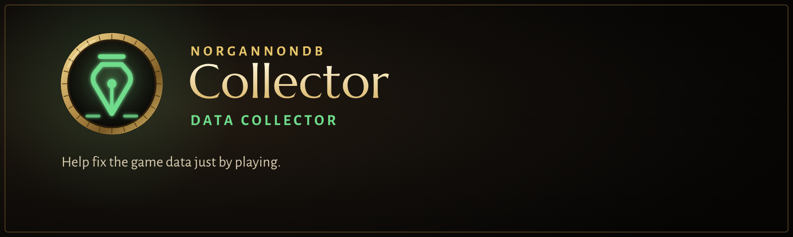

<p align="center">
  
</p>

<p align="center">
  
  
  
</p>

> [!WARNING]
> **Very much a work in progress.** This is an early build for WoW Forever (client 1.60.1), in
> active development and testing. Expect missing features, rough edges, bugs, and changes that
> break things between versions. Bug reports and feedback are welcome in
> [Issues](../../issues).

**Play as you always do. Every NPC, quest and drop you see makes the database better.**

[NorgannonDB](https://github.com/zmarotrix/NorgannonDB) is the open game database behind
Clairvoyance and Oracle. It started from Questie and pfQuest, but WoW Forever changed spawns,
quests and drops, and some things, like boss drop chances, were never known at all. The Collector
fills those gaps from real play, and everyone who uses the suite benefits. It also notes what
each class learns, at which level and for how much, so the game's training lists can be checked
after every patch.

## Why run it

- **Nothing to do.** It works quietly in the background, with no windows or prompts while you
  play, and it saves its work until after combat so it never slows a fight.
- **Private.** No character names and no other players are ever recorded or shared.
- **Rewarding.** At each login it shows what your last session found, including things
  NorgannonDB had wrong or didn't know.

## Sharing what you found

1. Type **`/ndbc share`** in game. A window opens with your finds ready to copy.
2. Press **Ctrl+C**.
3. In the **[Norgannon Discord](https://discord.gg/mvnuGyfMxB)**, open **#share-finds**, press **Ctrl+V**, then **Enter**.
   It's long, so Discord turns it into a file. That's fine.

Each share holds everything you've recorded so far, and a new one replaces your last, so share again whenever you
like. At login the Collector says, at most once a day, when you have something new (`/ndbc reminder off` stops
that). Every share is checked when it arrives, and a change to the game data needs more than one player behind it
before it goes into an update. By sharing you let your data be included in NorgannonDB, which is published under
GPL-3.0. It contains no character names.

## Commands

| Command | What it does |
|---|---|
| `/ndbc share` | copy your finds to paste in Discord (`/ndbc export` still works) |
| `/ndbc reminder on\|off` | say once a day at login when you have something new to share |
| `/ndbc stats` | what you've recorded so far |
| `/ndbc report [type] [n]` | what you found that NorgannonDB has wrong or missing |
| `/ndbc verbose` | announce each new finding in chat |
| `/ndbc pause` | stop or resume collecting |
| `/ndbc corrections on\|off` | apply the merged corrections that ship with the add-on |
| `/ndbc debug [show [n] \| chat \| clear]` | log what it sees and why it skips things (never shared) |
| `/ndbc reset` | delete everything collected |

## Getting started

Download the Collector and **[NorgannonDB](https://github.com/zmarotrix/NorgannonDB)** (on each
page: **Code → Download ZIP**), extract them into your WoW Forever `Interface/AddOns` folder, and
remove the `-main` GitHub adds to each folder's name (`NorgannonDBCollector`, `NorgannonDB`). That's
it: the Collector starts working the next time you log in.

## The NorgannonDB suite

|   | Add-on | |
|:-:|---|---|
|  | **[Clairvoyance](https://github.com/zmarotrix/Clairvoyance)** | Quest helper: your objectives on the map, minimap and compass, and a modern tracker |
|  | **[Oracle](https://github.com/zmarotrix/Oracle)** | Dungeon and zone atlas: maps, bosses, loot, zones and professions |
|  | **[NorgannonDB](https://github.com/zmarotrix/NorgannonDB)** | The open game database underneath, with **[NorgannonDB Core](https://github.com/zmarotrix/NorgannonDB_Core)**, the shared runtime |
|  | **NorgannonDB Collector** | Help map Azeroth: improves the database while you play |
|  | **[Retrospect](https://github.com/zmarotrix/Retrospect)** | Your characters, account-wide: what each one has, knows and has waiting |

---

## Technical details

<details>
<summary><b>What it records</b> (SavedVariables <code>NorgannonDBCollectorDB</code>, account-wide)</summary>

| Data | Source | Stored as (SPEC.md shapes) |
|---|---|---|
| NPCs: name, level range, rank, subName, position | target / mouseover within ~10 yd, every interaction | `npcs[id].spawns = {[areaId]={{x,y}}}` |
| Objects: position, name | looting / gathering | `objects[id].spawns` |
| Kills and loot | `PARTY_KILL` (or XP message), loot window sources | `obs.kills`, `obs.looted`, `obs.loot[itemId]` → `drops` chances at logout |
| Pickpocket / skinning / container loot | spell cast before the loot window; opened bag item | `obs.pickpocketLoot`, `obs.skinningLoot`, `items[id].obs.loot` |
| Quests: giver, ender, objectives (text, type, required count), rewards | quest dialogs + quest log | `quests[id].starters/finishers/objectives/rewards` |
| Which objective a mob counts for: the game's own quest lines under its name (quest title and objective), out of combat, once per mob; lines other add-ons add are never read. `/ndbc tips` says what the client gives | unit tooltips (`TooltipDataProcessor`, the game's QuestTitle / QuestObjective lines) | `quests[id].tips[objective][npcId]` |
| Quest chains: the NPC offers the next quest straight after a turn-in (no quest menu in between, no level-up); seeing a quest offered while a supposed prerequisite isn't done rules that one out | quest dialogs, gossip and greeting menus, completed quests | `quests[id].obs.after[prevId]`, `obs.notAfter[prevId]` |
| Vendors: items and stock | merchant window | `npcs[id].sells`, `items[id].vendors` |
| Services | gossip, merchant, trainer, flight map, bank, AH, stable, innkeeper frames | `npcs[id].flags` (NorgannonDB `npcFlags`) |
| Trainers: every service, not only the ones you can learn now (the trainer's filters are turned on for the read and put back): spell, rank, level, skill and earlier ranks needed, price and your standing with the trainer | trainer window (`C_TooltipInfo.GetTrainerService` for the spell) | `trainers[npcId].teaches[CLASS or "*"][spellId]`, each with the client build |
| What a class learns away from trainers: with a level, from a quest (and to which race), from a book (talents left out) | `LEARNED_SPELL_IN_SKILL_LINE` after a level-up, turn-in or item use | `classes[CLASS].learned[spellId]` |
| Level-ups: health, mana, talent points and stat gains | `PLAYER_LEVEL_UP` | `classes[CLASS].levels[race][level]` |
| Skill caps (weapons, defense, professions) as they rise | `SKILL_LINES_CHANGED` | `classes[CLASS].skills[skillId].max[level]` |

Evidence the SPEC has no field for (sighting counts, loot counts, objective text) is kept in
each record's `obs`. Players and pets are never recorded. Nothing in the world is read in combat
(kills are buffered and counted afterwards; a level-up's own numbers are kept) and no positions are taken inside instances (the game
doesn't give them there). Secret values are skipped and no protected function is called.

</details>

<details>
<summary><b>Importing data</b> (maintainer)</summary>

Save the strings players send you in text files. A file can hold any number of them, with other
text around them. Or copy one string and use `--clipboard`:

```bash
python tools/norgannondb/import_collected.py inbox/*.txt --merge
python tools/norgannondb/import_collected.py --clipboard --merge
python tools/norgannondb/import_collected.py "<WoW>/_forever_/WTF/Account/<ACCOUNT>/SavedVariables/NorgannonDBCollector.lua" --merge
```

Each player's data is stored once in `build/collected/submissions/<contributor>.lua`, and a newer
export replaces an older one. `--merge` runs the merge below over all of them and writes
`build/collected/corrections.json` (to review) and `build/collected/Corrections.lua`. Copy the
latter to `addons/NorgannonDBCollector/Corrections.lua` to use the corrections in game.

</details>

<details>
<summary><b>Feeding it back into NorgannonDB</b> (maintainer)</summary>

```bash
python tools/norgannondb/merge_collected.py "<WoW>/_forever_/WTF/Account/<ACCOUNT>/SavedVariables/NorgannonDBCollector.lua" --json build/collected/corrections.json --into sources/collected/corrections.json
```

Class training goes the same way: a spell must be in the game client (its SpellName table), a new entry needs
two players (or Maro), and a level or price NorgannonDB already has needs two players agreeing. The `--json`
output also lists `levelGains`. NorgannonDB's `training` (SPEC.md, schema 1.5) is what add-ons read: class →
spell with rank, level, full price, trainers, faction, and the quest or book that teaches it.

Review the `--json` output, then rebuild with `tools/build_all.py`: `--into` keeps the additions in a
file the build folds into NorgannonDB, so every player gets them (provenance `collector` for records
only players have seen). `--lua` still writes a `Corrections.lua` that only reaches Collector users.

QuestieDB stays the source of truth. A field QuestieDB provides is only changed after
`--min-override` (default 3) observations. Data QuestieDB lacks needs `--min-add` (1). Drop chances
need `--min-kills` (20) looted corpses and a difference beyond 3 standard errors, and quest items
never get one, because they only drop while you're on the quest. Candidates below those thresholds
are listed as "held back". A quest offered straight after another gets that one as a prerequisite
(`prerequisites.any`) after `--min-chain` (1) sightings, but only when QuestieDB gives it no
prerequisites at all. One sighting of it offered while that quest wasn't done keeps the pair out, and
takes it back out of `corrections.json` if an earlier run added it. Files from before `--min-build` (the first released client) are skipped as
beta data. New items get their names from the installed client's tables.

</details>

<details>
<summary><b>Licence</b></summary>

The Collector is free to download and use. The source is published for transparency, but all
rights are reserved for now; see [LICENSE](LICENSE). Made by **Maro**.

</details>
